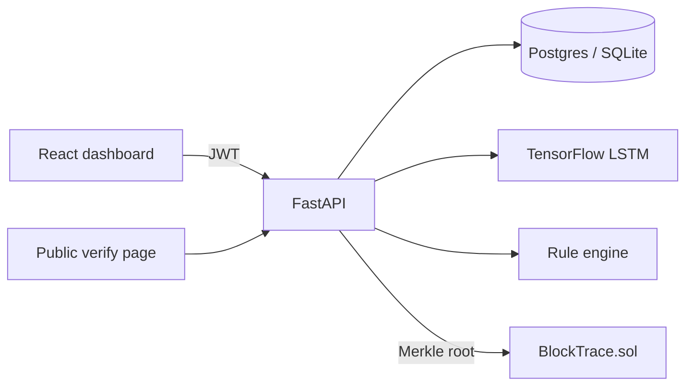

# BlockTrace — Blockchain + Deep Learning Transaction Tracker

> Follow every rupee from release to recipient. Every payment gets its own cryptographic token, every transfer is linked to the token that funded it, and an LSTM plus a rule engine flag suspicious flows in real time.

Built to make public-fund leakage **visible and provable**: citizens can verify a token without logging in, auditors can freeze suspicious money, and nobody can quietly edit history.

## Features

| Area | What it does |
|---|---|
| **Unique token per payment** | SHA-256 over the payload plus 128 bits of fresh randomness. No two payments share a token. |
| **Money-trail tracing** | A payment that forwards funds creates a *child token* linked to its parent. Walk the whole tree from the original allocation to final recipients, with unspent balance and hop count. |
| **No overspending** | A holder can only forward what a token has left, and only the current holder can forward it (enforced in both the API and the smart contract). |
| **Tamper-evident ledger** | Every record is hash-chained to the previous one. `GET /ledger/verify` re-checks the whole chain publicly and names the exact record that was altered. |
| **Merkle anchoring** | Batches of records are sealed into a Merkle root, optionally written to a blockchain. Anyone can fetch an inclusion proof for a token. |
| **LSTM anomaly detection** | 2-layer LSTM over each sender's last 10 payments scores every new transaction in real time. |
| **Rule engine** | Structuring (just under the reporting limit), rapid pass-through, circular flows, bursts, flagged accounts. Combined with the LSTM using noisy-OR, so either signal can raise an alarm. |
| **Explainable alerts** | Every alert carries plain-language reasons. Auditors can investigate, **freeze** a token, resolve, or dismiss as a false positive. |
| **Role-based access** | `officer` records payments, `auditor` handles alerts and exports, `admin` anchors and manages users. |
| **Public verification** | `/public/verify/{token}` shows a citizen the genuine record and where the money went, without internal risk data. |
| **Tamper-evident audit log** | Every sensitive action is logged in its own hash chain. |
| **Ops** | JWT auth, bcrypt, rate limiting, security headers, request IDs, health/readiness probes, Postgres, Docker, CI. |

## Architecture



- `contracts/` — Solidity (OpenZeppelin AccessControl, Pausable, ReentrancyGuard) + Hardhat tests
- `backend/` — FastAPI service, ledger crypto, rule engine, and `ml/` (features, data, training, inference)
- `frontend/` — React + Vite dashboard with the money-trail flow graph

## Quick start (local)

```bash
cp .env.example .env            # fill in SECRET_KEY, POSTGRES_PASSWORD, ADMIN_PASSWORD
make install
make train                      # trains the LSTM, writes backend/ml/artifacts/
export ADMIN_PASSWORD=...       # then:
make seed                       # creates admin/auditor/officer + a demo corruption scenario
make run-api                    # http://localhost:8000/docs
make run-web                    # http://localhost:5173
```

Production-style (Postgres + nginx):

```bash
docker compose up --build       # web :8080, api :8000
```

Smart contract (needs internet to download the Solidity compiler):

```bash
cd contracts && npm ci && npx hardhat test
npx hardhat node                # terminal 1
npm run deploy:local            # terminal 2, then set CHAIN_* in .env to anchor on-chain
```

## The fraud model

Input: the sender's last 10 payments, 9 features each (log amount, time gap, hour of day as sin/cos, amount vs own history, new counterparty, round amount, near reporting threshold, burst velocity). Architecture: Masking → LSTM(64) → Dropout → LSTM(32) → Dense(32) → Sigmoid. The decision threshold is tuned on a validation split; the numbers below are on an untouched test split.

Benchmark on the synthetic dataset in `ml/data.py` (40,000 sequences, ~10.6% fraud, 6,000 held out, noisy labels, hard negatives like night-time payments and large honest invoices):

| Accuracy | Precision | Recall | F1 | ROC-AUC | False-positive rate |
|---|---|---|---|---|---|
| 98.5% | 96.1% | 89.4% | 92.6% | 0.954 | 0.43% |

Always-say-legit scores 89.4% accuracy on this data, which is why precision and recall are reported alongside accuracy. Re-run `make train` to reproduce; results are saved to `backend/ml/artifacts/metrics.json` and shown on the dashboard.

**Limitations (be upfront about these):** real government ledgers are confidential, so the model is trained and benchmarked on **synthetic** fraud typologies. Real-world performance will be lower until it is retrained on labelled data. Swap `generate_dataset` for a real export and re-run training.

## API overview

`POST /auth/login` · `POST /transactions` · `GET /transactions/{token}/trace` · `GET /transactions/{token}/proof` · `GET /alerts` · `PATCH /alerts/{id}` (freeze/resolve) · `GET /ledger/verify` · `POST /ledger/anchor` · `GET /public/verify/{token}` · `GET /stats` · `GET /transactions/export.csv`. Interactive docs at `/docs` in development.

## Security notes

- No default credentials; the seeder refuses to run without `ADMIN_PASSWORD`. The API refuses to start in production with the placeholder `SECRET_KEY`.
- Passwords are hashed with bcrypt; login errors never reveal whether a username exists.
- CSV export neutralises spreadsheet-formula injection. Responses carry `nosniff`, `X-Frame-Options`, and `no-store`.
- Money is stored as integer paise, never floats.
- Single-process rate limiter: put Redis behind it (or use an API gateway) before running multiple replicas.
- The hash chain is serialised with an in-process lock plus a Postgres advisory lock; run one API writer per database or keep the advisory lock.

## Roadmap

Real-data retraining and drift monitoring · SHAP explanations for the LSTM · graph neural network over the account graph · Redis rate limiting · multi-chain anchoring (Polygon) · email/SMS alerts to auditors · RTI-style public dashboards.

## License

MIT
